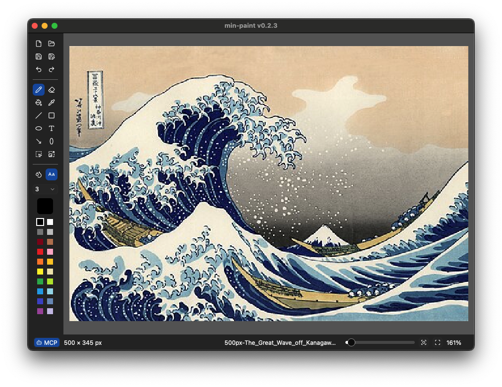

# min-paint

A simple paint application similar to classic MS Paint with MCP — built for people who hate the new Windows 11 Paint.




## Installing

Download the latest [min-paint release](https://github.com/naotsugu/min-paint/releases) and unzip it.

### Launching app on macOS

By default, macOS allows you to open apps from the official Mac App Store only. If you have this still set as your default, you will be seeing the warning when you try to open an app for the first time.

The easiest way to allow an app from an unidentified developer to run on macOS is to ⌘-click the app and click Open.

    Press ⌘ while clicking the app
    Click the Open button from the shortcut menu.
    Click Open again.

After that, the app will be saved as a safe app to open, and you can double-click to use it in the future as you can with any registered apps.

### Launching app on Windows

If Windows **Smart App Control** or **Microsoft Defender SmartScreen** blocks the executable after downloading:

#### Method 1: Unblock via File Properties (Recommended)
1. Right-click the downloaded `min-paint.exe` file and select **Properties**.
2. In the **General** tab at the bottom, find the **Security** section.
3. Check the **Unblock** box (許可する), then click **Apply** and **OK**.
4. Run `min-paint.exe` (if you unblocked the `.zip` file, extract it first).

> **Tip:** Unblocking the `.zip` file before extracting ensures all extracted files are unblocked automatically.

#### Method 2: Unblock via PowerShell

Open PowerShell in the folder where the file is located and run:

```powershell
Unblock-File -Path .\min-paint.exe
```
*(or `Unblock-File -Path .\min-paint-*.zip` before extracting)*

#### Windows SmartScreen popup

If you see a "Windows protected your PC" prompt:

1. Click **More info**.
2. Click **Run anyway**.


## How to build

### Apple silicon

```shell
cargo build --target aarch64-apple-darwin
```

```shell
cargo install cargo-bundle
cargo bundle --release
```

### Intel Mac

```shell
cargo build --target x86_64-apple-darwin
```

```shell
cargo install cargo-bundle
cargo bundle --release
```

### Linux

```shell
cargo zigbuild --target x86_64-unknown-linux-gnu.2.17
```

### Windows

```shell
cargo build --release
```

### Linux/macOS → Windows (MSVC)

```shell
cargo install cargo-xwin
cargo xwin build --target x86_64-pc-windows-msvc
```
