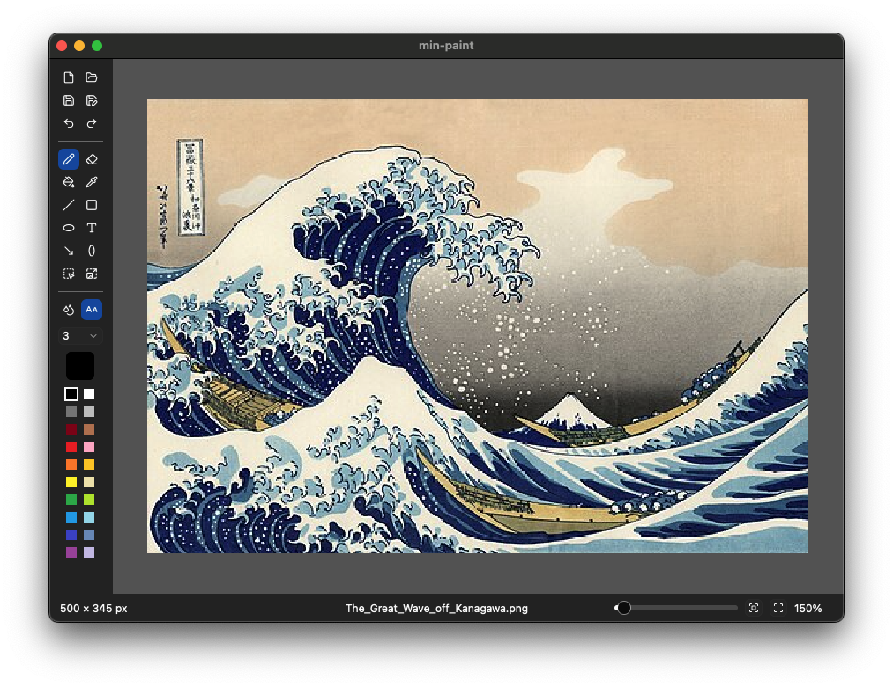

# min-paint

Minimal paint application.




## Installing

Download the latest [min-paint release](https://github.com/naotsugu/min-paint/releases) and unzip it.

### Launching app on macOS

By default, macOS allows you to open apps from the official Mac App Store only. If you have this still set as your default, you will be seeing the warning when you try to open an app for the first time.

The easiest way to allow an app from an unidentified developer to run on macOS is to ⌘-click the app and click Open.

    Press ⌘ while clicking the app
    Click the Open button from the shortcut menu.
    Click Open again.

After that, the app will be saved as a safe app to open, and you can double-click to use it in the future as you can with any registered apps.


## How to build

### Apple silicon

```shell
cargo build --target aarch64-apple-darwin
```

```shell
cargo install cargo-bundle
cargo bundle --release
```

### Intel Mac

```shell
cargo build --target x86_64-apple-darwin
```

```shell
cargo install cargo-bundle
cargo bundle --release
```

### Linux

```shell
cargo zigbuild --target x86_64-unknown-linux-gnu.2.17
```

### Windows

```shell
cargo build --release
```

### Linux/macOS → Windows (MSVC)

```shell
cargo install cargo-xwin
cargo xwin build --target x86_64-pc-windows-msvc
```
