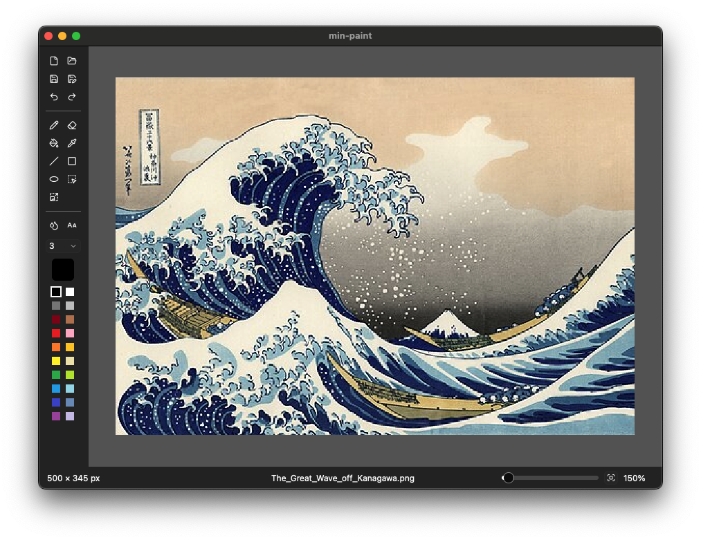

# min-paint

Minimal paint application.



## How to build

### Apple silicon

```shell
cargo build --target aarch64-apple-darwin
```

```shell
cargo install cargo-bundle
cargo bundle --release
```

### Intel Mac

```shell
cargo build --target x86_64-apple-darwin
```

```shell
cargo install cargo-bundle
cargo bundle --release
```

### Linux

```shell
cargo zigbuild --target x86_64-unknown-linux-gnu.2.17
```

### Windows

```shell
cargo build --release
```

### Linux/macOS → Windows (MSVC)

```shell
cargo install cargo-xwin
cargo xwin build --target x86_64-pc-windows-msvc
```
